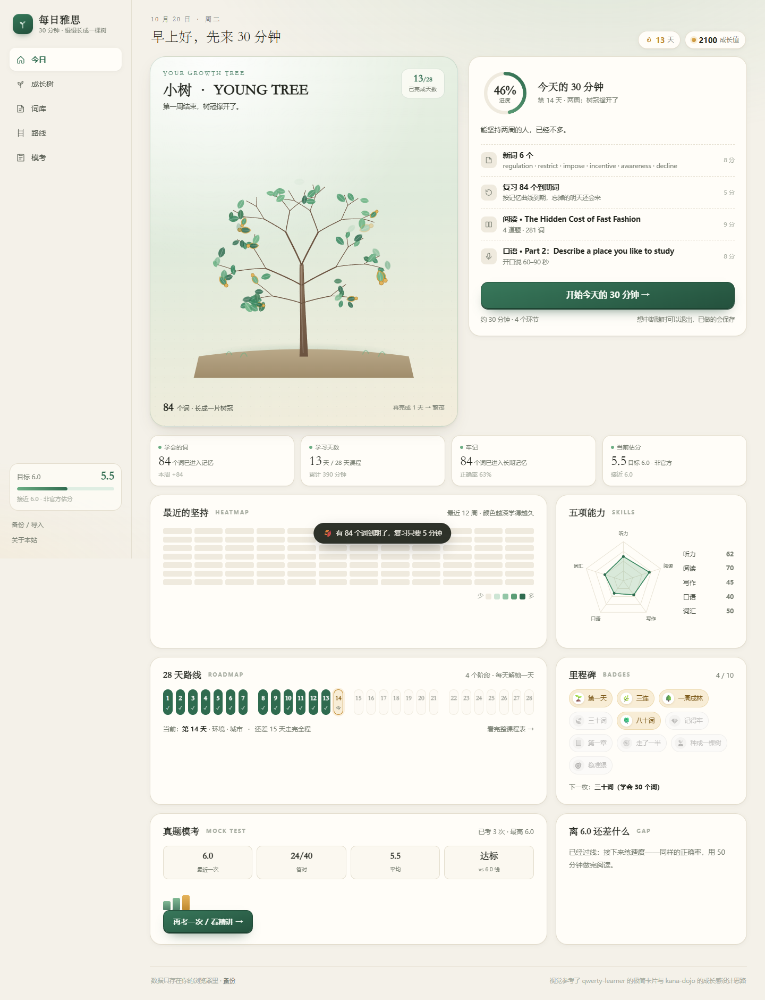
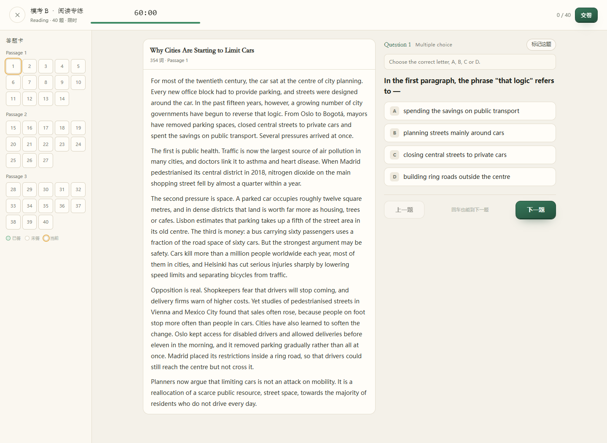

# 每日雅思学习站 · IELTS Daily

> 一个**纯前端、无后端、零依赖**的雅思每日学习站。每天 30 分钟：6 个新词 + 到期复习 + 阅读/听力 + 写作/口语，28 天一轮，学过的词会变成首页那棵树上的一片叶子。

**English**: A local-first IELTS practice web app. 30 minutes a day, spaced repetition for vocabulary, daily reading/listening/writing/speaking drills, a growing-tree visualisation, and two built-in mock papers with answer sheets and per-question explanations. No backend, no build tools required to run, all data stays in your browser.



---

## 它解决什么问题

雅思资料不缺，缺的是「今天到底做什么」。

这个站把宽泛的「学雅思」拆成每天 4 个可执行环节，按 CET4 起点（约雅思 4.5）排难度：

| 环节 | 时长 | 内容 |
| --- | --- | --- |
| 新词 6 个 | ≈8 分钟 | 先猜 → 听音 → 翻面 → 自评「忘了 / 有点印象 / 记住了」 |
| 到期复习 | ≈5 分钟 | 按 1/3/7/15/30 天间隔到期自动出现，每天最多 12 个，超出的进欠账队列 |
| 阅读 **或** 听力 | ≈9 分钟 | 280 词短文 4 题 / 对话 4 题 + 2 句听写 |
| 写作 **或** 口语 | ≈8–10 分钟 | 句子翻译 / 段落骨架 / 小作文图表 / 口语话题卡 |

## 它**不**解决什么（重要）

28 天 × 30 分钟 = **14 小时**。而从 4.5 到 6.0，业界估算需要 **250–350 小时**有效学习——差 18–25 倍。

所以这个站的定位是：**把「今天坐下来学 30 分钟」变成不需要决心的事，并诚实告诉你离 6.0 还有多远**。它不承诺提分，也没有任何「28 天速成」。

页面上的估分锚定在最近一次模考成绩上（练习表现只能在 ±0.5 内浮动），没模考就显示「—」，不凭空给数字。

## 截图

| 模考 | 答题卡 |
| --- | --- |
|  |  |

## 功能

- **每日闭环**：4 个环节 → 收束 → 结算，随时可中途退出，已做的会保存
- **间隔重复**：stage 1/3/7/15/30 天，评价三档驱动升降；每日复习上限 12 词，欠账次日优先，保证 30 分钟封顶
- **28 天之后不结束**：第 29 天自动进入第 2 轮，复用篇目标「复习篇」，日期与轮次一路顺延
- **成长可视化**：成长之树（叶片=学过的词，金叶=长期记忆）、12 周热力图、五项能力雷达、估分
- **模拟模考**：套题 A（听力 40 + 阅读 40）、套题 B（阅读 40）；限时/宽松模式、答题卡四态、听力/阅读分表换算、逐题精讲、成绩历史
- **发音**：Web Speech API，默认**美音**，词库可切英音/澳音，按质量给系统音色打分再选
- **数据**：localStorage 单键 + 每日滚动快照（保留 7 份）+ JSON 备份/导入
- **响应式**：桌面左侧导航，手机底部 tab

## 快速开始

三种方式，任选其一，都不需要安装任何依赖：

```bash
# 方式 1（最快）：直接双击 index.html —— 站点已是打包好的经典脚本，file:// 可运行

# 方式 2：起一个本地服务器（推荐，避免个别浏览器在 file:// 下禁 localStorage）
python -m http.server 8000
# 然后打开 http://127.0.0.1:8000

# 方式 3：Windows 双击 启动.cmd（自动起服务并打开浏览器）
# 没有 Python 时：node server.js
```

> 为什么不直接用 `<script type="module">`：浏览器在 `file://` 下会以 CORS 为由拒载 ES Module，页面会变成一张点不动的空壳。所以源码保持模块化，运行时用 `build.mjs` 打成单文件经典脚本。

## 部署

### GitHub Pages（推荐）

仓库自带 `.github/workflows/pages.yml`，推送到 `main` 即自动部署：

1. 打开仓库 **Settings → Pages**
2. **Source** 选 `GitHub Actions`
3. 推一次代码（或手动跑一次 workflow）
4. 访问 `https://<你的用户名>.github.io/ielts-daily/`

站点全部使用相对路径，部署在子路径下也能正常工作。CI 里有一道检查：如果 `assets/app.bundle.js` 与源码不同步，构建会失败，避免线上跑旧代码。

> 不想用 Actions？把 Pages 的 Source 改成 `Deploy from a branch` → `main` / `root` 也可以（仓库已含 `.nojekyll`）。

### 其他静态托管

这是纯静态站点，构建产物已经提交在仓库里，**任何静态托管都能直接放**：

| 平台 | 做法 |
| --- | --- |
| Netlify / Vercel / Cloudflare Pages | 导入仓库，构建命令留空（或 `node build.mjs`），发布目录 `/` |
| 对象存储（OSS / COS / S3） | 把仓库根目录全部上传，开启静态网站托管，默认首页 `index.html` |
| Nginx | `root /path/to/repo; index index.html;` 即可 |

## 开发

```bash
node build.mjs      # 把 assets/*.js 打包成 assets/app.bundle.js（改了源码必须重跑）
node server.js      # 本地静态服务器（8000 端口）
```

**改源码后一定要 `node build.mjs`**——页面加载的是打包产物，不是 `assets/app.js`。

### 测试

```bash
npm i -D jsdom     # 只有 DOM / 流程 / 发音测试需要
npm test           # 逻辑测试，零依赖，直接跑
npm run test:all   # 全部 6 套，125 条断言
```

| 测试 | 条数 | 覆盖 |
| --- | --- | --- |
| `tests/logic.test.mjs` | 32 | 课程轮次、时长估算、复习上限、分表换算、80 题折算、自评记分、存档迁移、快照 |
| `tests/dom.test.mjs` | 16 | 五个页面渲染、第 29 天不白屏、估分锚定 |
| `tests/bundle.test.mjs` | 21 | **file:// 下执行打包产物**（等价于双击） |
| `tests/flow.test.mjs` | 17 | 开始练习 → 6 个词 → 退出保存 → 模考交卷 → 估分出分 |
| `tests/e2e.test.mjs` | 19 | **连点第 1–3 天到结算，零未捕获错误** |
| `tests/speech.test.mjs` | 20 | 默认美音、音色打分挑选、口音切换持久化、无对应音色的兜底 |

## 目录结构

```
.
├─ index.html                 外壳：导航 / 今日 / 练习 / 结算 / 弹层
├─ 启动.cmd                   Windows 一键起服务
├─ server.js                  零依赖静态服务器（Node 兜底）
├─ build.mjs                  迷你打包器：assets/*.js → assets/app.bundle.js
├─ assets/
│  ├─ app.bundle.js           打包产物（勿手改），index.html 加载的就是它
│  ├─ app.js                  视图渲染 / 会话流程 / 结算 / 数据管理
│  ├─ store.js                存档、间隔重复、自评记分、复习预算、快照
│  ├─ course.js               28 天课表 + 轮次换算（第 29 天 = 第 2 轮）
│  ├─ drills.js               五种练习：词汇 / 阅读 / 听力 / 写作 / 口语
│  ├─ exam.js                 模考引擎：计时 / 答题卡 / 判分 / 精讲
│  ├─ speech.js               发音：口音偏好 + 音色打分
│  ├─ tree.js                 成长之树：递归长枝 + 叶片分布
│  ├─ style.css               视觉系统（纸感暖白 + 墨绿 + 金色）
│  └─ data/                   词库 / 阅读 / 听力 / 写作口语 / 两套模考
├─ tests/                     6 套测试
├─ docs/
│  ├─ screenshots/            截图
│  ├─ 2026-10-20-每日雅思学习站使用与设计说明.md   功能与技术细节
│  └─ 2026-10-20-每日雅思学习站PRD.md             产品定义、范围、质疑与决策记录
└─ .github/workflows/pages.yml
```

## 数据与隐私

- 所有学习记录只存在**你自己的浏览器**（localStorage），没有任何上传、没有账号、没有埋点。
- 每日自动留一份快照（保留 7 天），清缓存后还能从最近一份恢复。
- 唯一可能的网络行为是浏览器自带的语音合成：部分系统的音色由云端提供。
- 换设备请用「备份 / 导入」导出 JSON。

## 设计文档

- [使用与设计说明](docs/2026-10-20-每日雅思学习站使用与设计说明.md)：功能细节、数据结构、技术实现
- [PRD](docs/2026-10-20-每日雅思学习站PRD.md)：产品定义、范围、成功标准、技术债清单、质疑与决策记录

## 已知限制

- 内容量有限：168 词 / 4 篇阅读 / 8 段听力 / 8 个写作任务 / 4 个口语话题 / 2 套模考；第 10 天之后会出现复用篇目（已标注「复习篇」）。
- 写作与口语**没有自动评分**，只有自评三档 + 范文对照 + 自查清单。
- 听力靠浏览器 TTS，不是真人录音；Windows 上若没有网络音色，会偏机械。
- 单词表是自选高频词，尚未按 AWL 子表重排。
- 单设备、单浏览器；不做账号与云同步。

## 免责声明

- 模考题为**自行编写**，不是雅思官方真题，也不来自任何真题集；难度与题型参考公开的考试结构。
- 分数换算表是业界常用的近似值，**不是官方评分标准**。
- 本项目与 British Council、IDP、Cambridge 无任何关联。

## 许可

[MIT](LICENSE) © 2026 the ielts-daily authors

## 致谢

交互与节奏设计参考了两个开源项目的思路（代码为本项目原创）：

- [qwerty-learner](https://github.com/Kaiyiwing/qwerty-learner)：纯前端背单词的极简卡片，以及「学 + 复习」分开组织
- [kana-dojo](https://github.com/lingdojo/kana-dojo)：把语言学习做成有成长感的小游戏，模块化拆分
